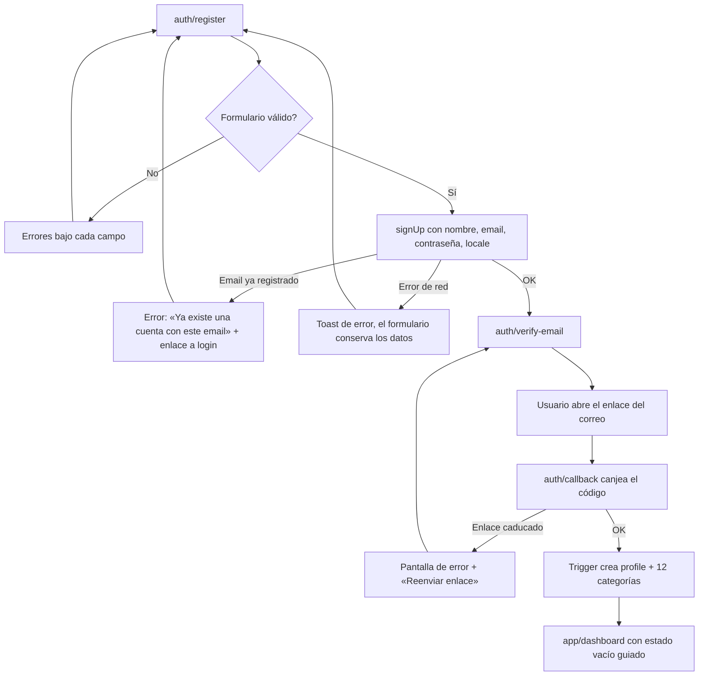
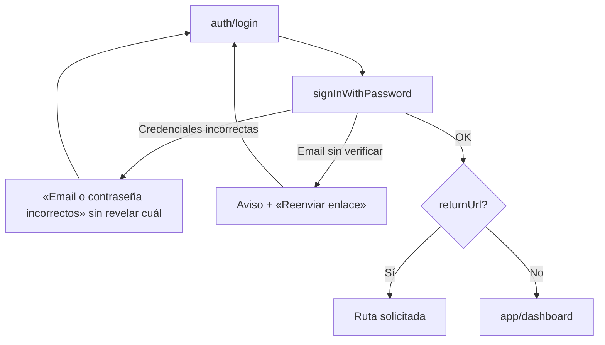
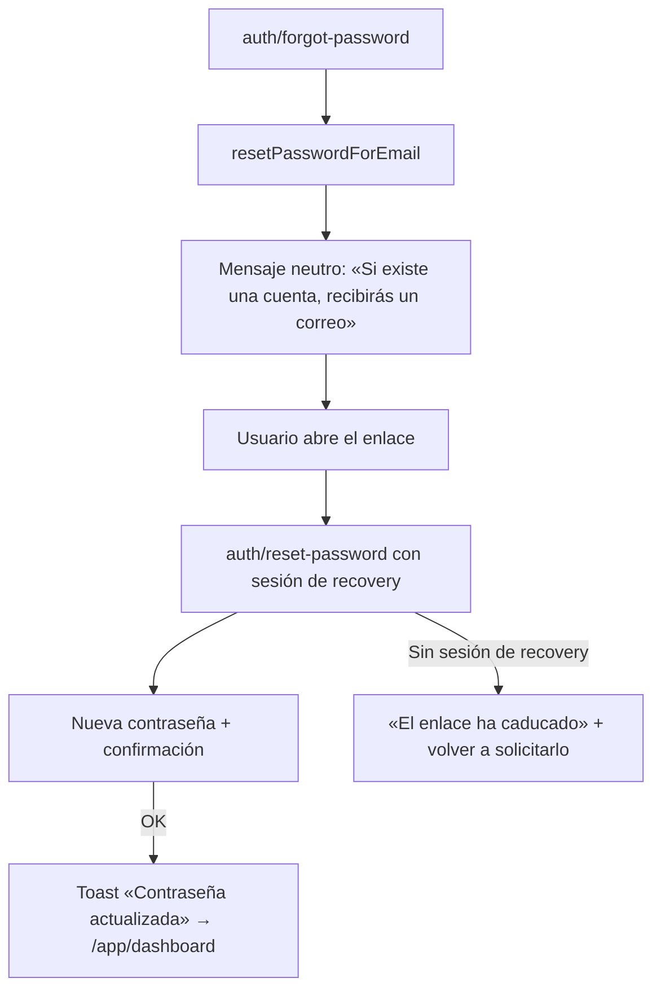
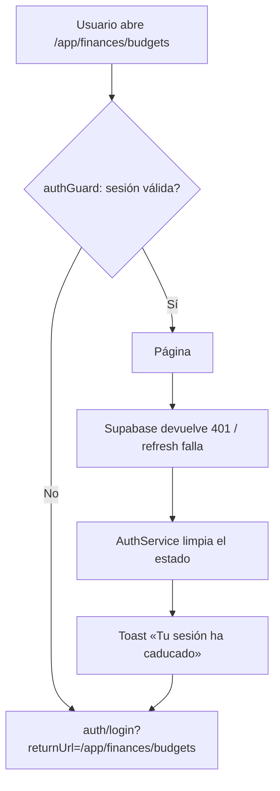
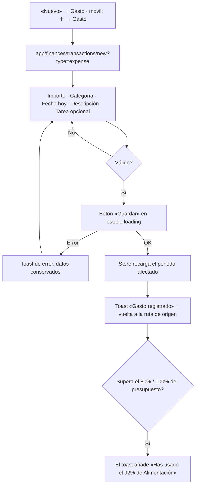
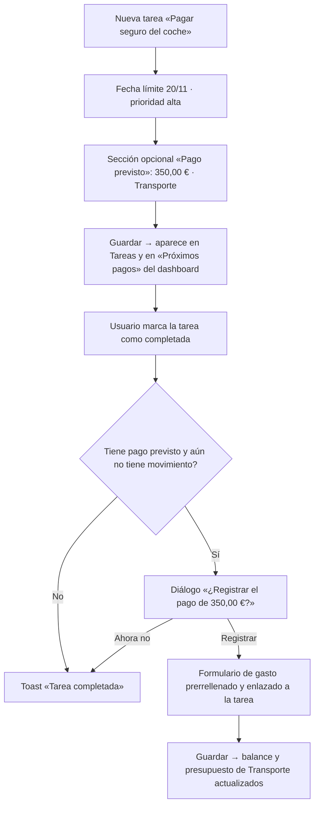
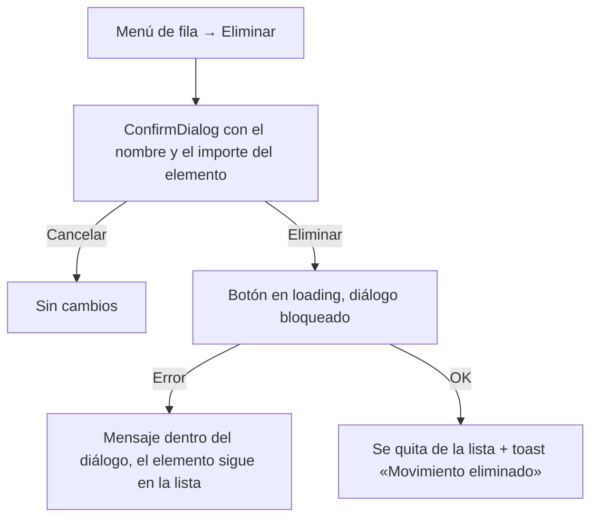
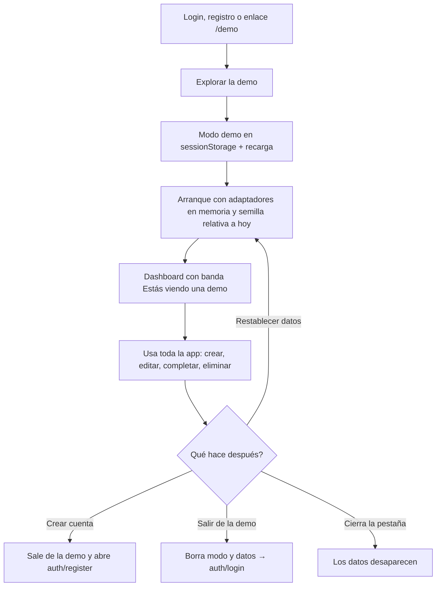

# 5. Flujos de usuario

Cada flujo indica qué pasa en escritorio y en móvil cuando difieren. Todas las escrituras siguen la regla de la especificación: **nunca se muestra éxito si el backend no lo ha confirmado** (sin actualizaciones optimistas en finanzas).

## F-01 · Registro y verificación (US-001)

## F-02 · Inicio de sesión (US-002)

## F-03 · Recuperar contraseña (US-004)

## F-04 · Acceso protegido y sesión expirada (US-002/003)

## F-05 · Cerrar sesión (US-003)

Avatar → «Cerrar sesión» → `signOut()` → se limpian todos los stores de feature → `/auth/login`. En móvil, desde Ajustes → Perfil.

## F-06 · Registrar un gasto (US-021)

Editar (US-022) usa el mismo formulario en `/:id/edit`. Eliminar (US-023) sigue F-12.

## F-07 · Crear presupuesto (US-026)

`/app/finances/budgets` → «Nuevo presupuesto» → diálogo (móvil: hoja inferior) con categoría de gasto (solo las que aún no tienen presupuesto ese mes) e importe → Guardar → la tarjeta aparece con el gasto ya acumulado. Si la combinación categoría + mes ya existe (`23505`), error en el campo: «Ya tienes un presupuesto para esta categoría en noviembre». Acción «Copiar del mes anterior» cuando el mes está vacío.

## F-08 · Tarea con compromiso financiero (US-030, US-032, US-037) — el «nexo»

## F-09 · Completar y filtrar tareas (US-032, US-034)

- Checkbox en la fila → `status = completed`, `completed_at = now()`. La fila muestra spinner hasta la confirmación; si falla, vuelve a su estado y aparece un toast.
- Filtros: estado (Pendientes, En curso, Completadas, Todas) y prioridad (chips). Orden: vencimiento (por defecto), prioridad, creación. Los filtros viven en la URL.
- Móvil: los filtros se abren en una hoja inferior; el botón muestra el número de filtros activos.

## F-10 · Crear evento desde el calendario (US-035, US-036)

Calendario → clic en un día (móvil: tocar día → agenda del día → «＋ Evento») → `/calendar/events/new?date=2026-11-20` con inicio 09:00 y fin 10:00 por defecto → validación «el fin debe ser posterior al inicio» → Guardar → vuelve al calendario con el día seleccionado.

## F-11 · Dashboard y cambio de periodo (US-010 a US-014)

Selector de mes → actualiza `?month=` → el `DashboardService` recarga en paralelo resumen financiero, presupuestos, tareas y eventos → cada tarjeta gestiona su propio estado (loading / empty / error con «Reintentar»), así un fallo en eventos no oculta las finanzas. Cada tarjeta enlaza a su módulo con el filtro aplicado (US-014).

## F-12 · Eliminar (cualquier entidad)

Casos especiales: una categoría con movimientos no se puede eliminar (FK `restrict`), se ofrece **archivarla**. Eliminar una tarea deja sus movimientos sin enlace (`task_id → null`).

## F-13 · Perfil y preferencias (US-005)

- Perfil: nombre (guardar), email (cambio con verificación en el nuevo correo), contraseña (actual + nueva), eliminar cuenta (confirmación escribiendo «ELIMINAR» → Edge Function `delete-account` → cierre de sesión → `/auth/login` con toast «Tu cuenta se ha eliminado»).
- Preferencias: idioma ES/EN (aplica al instante y se guarda en `profiles.locale`), primer día de la semana (lunes/domingo).

## F-14 · Explorar la demo

