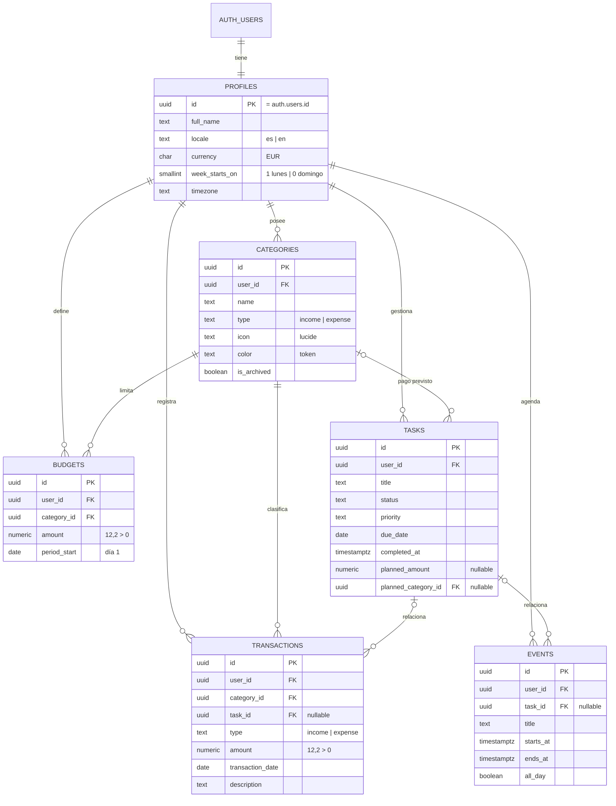

# 6. Modelo de datos definitivo

## Diagrama



## Decisiones de modelado

1. **Propiedad garantizada por FK compuestas.** Cada tabla de usuario tiene `UNIQUE (id, user_id)`. Las referencias usan `(category_id, user_id)` o `(task_id, user_id)`, así PostgreSQL **impide** que el usuario A use una categoría o tarea de B, sin triggers. Cubre la regla 3 de seguridad («comprobar la propiedad de los registros relacionados»).
2. **Tipo coherente entre movimiento y categoría.** La FK de `transactions` incluye `type`: `(category_id, user_id, type) → categories (id, user_id, type)`. Un gasto nunca puede tener una categoría de ingreso.
3. **Presupuestos solo de gastos.** `budgets.category_type` es una columna fija `'expense'` incluida en la FK compuesta.
4. **`user_id DEFAULT auth.uid()`.** El frontend no envía `user_id`; si lo envía, RLS (`WITH CHECK`) lo rechaza si no es el suyo.
5. **Dinero:** `NUMERIC(12,2)`, siempre positivo; el signo lo da `type`. En TypeScript se maneja en **céntimos enteros** dentro del dominio para evitar errores de coma flotante; el mapper convierte.
6. **Fechas:** movimientos y vencimientos `DATE`; eventos `TIMESTAMPTZ`; presupuestos con `period_start` siempre día 1.
7. **Borrados:** perfil → todo en cascada. Categoría con movimientos o presupuestos → `RESTRICT` (se archiva). Tarea → sus movimientos y eventos quedan con `task_id = NULL`.
8. **Coherencia de estado de tarea:** `completed_at` existe si y solo si `status = 'completed'`.
9. **Pago previsto (D-12):** `planned_amount` y `planned_category_id` van juntos o ninguno.

## SQL (borrador de la migración inicial)

```sql
create extension if not exists "pgcrypto";

create or replace function public.set_updated_at()
returns trigger language plpgsql as $$
begin
  new.updated_at = now();
  return new;
end $$;

create table public.profiles (
  id              uuid primary key references auth.users (id) on delete cascade,
  full_name       text not null check (char_length(btrim(full_name)) between 1 and 80),
  locale          text not null default 'es' check (locale in ('es', 'en')),
  currency        char(3) not null default 'EUR' check (currency = 'EUR'),
  week_starts_on  smallint not null default 1 check (week_starts_on in (0, 1)),
  timezone        text not null default 'Europe/Madrid',
  created_at      timestamptz not null default now(),
  updated_at      timestamptz not null default now()
);

create table public.categories (
  id           uuid primary key default gen_random_uuid(),
  user_id      uuid not null default auth.uid() references public.profiles (id) on delete cascade,
  name         text not null check (char_length(btrim(name)) between 1 and 40),
  type         text not null check (type in ('income', 'expense')),
  icon         text not null default 'circle' check (char_length(icon) <= 40),
  color        text not null default 'sand'
               check (color in ('sage', 'sand', 'mist', 'blush', 'butter', 'lavender', 'peach', 'mint')),
  is_archived  boolean not null default false,
  created_at   timestamptz not null default now(),
  updated_at   timestamptz not null default now(),
  unique (id, user_id),
  unique (id, user_id, type)
);
create unique index categories_user_type_name_uq on public.categories (user_id, type, lower(btrim(name)));

create table public.tasks (
  id                   uuid primary key default gen_random_uuid(),
  user_id              uuid not null default auth.uid() references public.profiles (id) on delete cascade,
  title                text not null check (char_length(btrim(title)) between 1 and 120),
  description          text check (char_length(description) <= 2000),
  status               text not null default 'pending' check (status in ('pending', 'in_progress', 'completed')),
  priority             text not null default 'medium' check (priority in ('low', 'medium', 'high')),
  due_date             date,
  completed_at         timestamptz,
  planned_amount       numeric(12,2) check (planned_amount > 0),
  planned_category_id  uuid,
  planned_category_type text not null default 'expense' check (planned_category_type = 'expense'),
  created_at           timestamptz not null default now(),
  updated_at           timestamptz not null default now(),
  unique (id, user_id),
  check ((status = 'completed') = (completed_at is not null)),
  check ((planned_amount is null) = (planned_category_id is null)),
  foreign key (planned_category_id, user_id, planned_category_type)
    references public.categories (id, user_id, type) on delete restrict
);

create table public.transactions (
  id                uuid primary key default gen_random_uuid(),
  user_id           uuid not null default auth.uid() references public.profiles (id) on delete cascade,
  category_id       uuid not null,
  task_id           uuid,
  type              text not null check (type in ('income', 'expense')),
  amount            numeric(12,2) not null check (amount > 0 and amount <= 9999999999.99),
  transaction_date  date not null,
  description       text check (char_length(description) <= 200),
  created_at        timestamptz not null default now(),
  updated_at        timestamptz not null default now(),
  foreign key (category_id, user_id, type)
    references public.categories (id, user_id, type) on delete restrict,
  foreign key (task_id, user_id)
    references public.tasks (id, user_id) on delete set null (task_id)
);

create table public.budgets (
  id             uuid primary key default gen_random_uuid(),
  user_id        uuid not null default auth.uid() references public.profiles (id) on delete cascade,
  category_id    uuid not null,
  category_type  text not null default 'expense' check (category_type = 'expense'),
  amount         numeric(12,2) not null check (amount > 0),
  period_start   date not null check (extract(day from period_start) = 1),
  created_at     timestamptz not null default now(),
  updated_at     timestamptz not null default now(),
  unique (user_id, category_id, period_start),
  foreign key (category_id, user_id, category_type)
    references public.categories (id, user_id, type) on delete restrict
);

create table public.events (
  id           uuid primary key default gen_random_uuid(),
  user_id      uuid not null default auth.uid() references public.profiles (id) on delete cascade,
  task_id      uuid,
  title        text not null check (char_length(btrim(title)) between 1 and 120),
  description  text check (char_length(description) <= 2000),
  location     text check (char_length(location) <= 120),
  starts_at    timestamptz not null,
  ends_at      timestamptz not null,
  all_day      boolean not null default false,
  created_at   timestamptz not null default now(),
  updated_at   timestamptz not null default now(),
  check (ends_at > starts_at),
  foreign key (task_id, user_id)
    references public.tasks (id, user_id) on delete set null (task_id)
);

create index transactions_user_date_idx on public.transactions (user_id, transaction_date desc);
create index transactions_user_category_idx on public.transactions (user_id, category_id);
create index transactions_task_idx on public.transactions (task_id) where task_id is not null;
create index budgets_user_period_idx on public.budgets (user_id, period_start);
create index tasks_user_status_due_idx on public.tasks (user_id, status, due_date);
create index events_user_starts_idx on public.events (user_id, starts_at);
create index categories_user_idx on public.categories (user_id) where not is_archived;

do $$
declare t text;
begin
  foreach t in array array['profiles', 'categories', 'tasks', 'transactions', 'budgets', 'events'] loop
    execute format('create trigger %1$s_updated_at before update on public.%1$s
                    for each row execute function public.set_updated_at()', t);
  end loop;
end $$;
```

### Alta de usuario

```sql
create or replace function public.handle_new_user()
returns trigger language plpgsql security definer set search_path = '' as $$
declare v_locale text := coalesce(new.raw_user_meta_data ->> 'locale', 'es');
begin
  insert into public.profiles (id, full_name, locale)
  values (new.id,
          coalesce(nullif(btrim(new.raw_user_meta_data ->> 'full_name'), ''), split_part(new.email, '@', 1)),
          case when v_locale in ('es', 'en') then v_locale else 'es' end);

  insert into public.categories (user_id, name, type, icon, color)
  select new.id, case when v_locale = 'en' then c.name_en else c.name_es end, c.type, c.icon, c.color
  from (values
    ('Nómina',        'Salary',        'income',  'briefcase',      'sage'),
    ('Extras',        'Side income',   'income',  'sparkles',       'mint'),
    ('Vivienda',      'Housing',       'expense', 'house',          'sand'),
    ('Alimentación',  'Groceries',     'expense', 'shopping-cart',  'butter'),
    ('Transporte',    'Transport',     'expense', 'car',            'mist'),
    ('Suministros',   'Utilities',     'expense', 'zap',            'peach'),
    ('Salud',         'Health',        'expense', 'heart-pulse',    'blush'),
    ('Ocio',          'Leisure',       'expense', 'ticket',         'lavender'),
    ('Restaurantes',  'Eating out',    'expense', 'utensils',       'peach'),
    ('Suscripciones', 'Subscriptions', 'expense', 'repeat',         'mist'),
    ('Seguros',       'Insurance',     'expense', 'shield-check',   'sage'),
    ('Otros',         'Other',         'expense', 'ellipsis',       'sand')
  ) as c(name_es, name_en, type, icon, color);
  return new;
end $$;

create trigger on_auth_user_created
  after insert on auth.users
  for each row execute function public.handle_new_user();
```

El trigger es `security definer` porque inserta en tablas con RLS antes de que exista sesión; `user_id` se pasa explícitamente porque `auth.uid()` es nulo en ese contexto.

## Row Level Security

Todas las tablas: `enable row level security`, sin acceso para `anon`, y una política por operación para `authenticated`. Se usa `(select auth.uid())` para que PostgreSQL evalúe la función una vez por consulta.

```sql
alter table public.profiles enable row level security;
create policy "profiles_select_own" on public.profiles for select to authenticated using ((select auth.uid()) = id);
create policy "profiles_update_own" on public.profiles for update to authenticated
  using ((select auth.uid()) = id) with check ((select auth.uid()) = id);

do $$
declare t text;
begin
  foreach t in array array['categories', 'tasks', 'transactions', 'budgets', 'events'] loop
    execute format('alter table public.%1$s enable row level security', t);
    execute format('create policy "%1$s_select_own" on public.%1$s for select to authenticated
                    using ((select auth.uid()) = user_id)', t);
    execute format('create policy "%1$s_insert_own" on public.%1$s for insert to authenticated
                    with check ((select auth.uid()) = user_id)', t);
    execute format('create policy "%1$s_update_own" on public.%1$s for update to authenticated
                    using ((select auth.uid()) = user_id) with check ((select auth.uid()) = user_id)', t);
    execute format('create policy "%1$s_delete_own" on public.%1$s for delete to authenticated
                    using ((select auth.uid()) = user_id)', t);
  end loop;
end $$;

revoke all on all tables in schema public from anon;
```

`profiles` no tiene `insert` ni `delete` para el cliente: los crea el trigger y se borran en cascada con `auth.users`.

## Lecturas agregadas para el dashboard

Para no descargar todos los movimientos del mes al navegador, el dashboard usa funciones `security invoker` (respetan RLS):

| Función | Devuelve |
|---------|----------|
| `finance_summary(p_from date, p_to date)` | `income`, `expense`, `balance` (céntimos) |
| `expenses_by_category(p_from date, p_to date)` | `category_id`, `name`, `icon`, `color`, `total` |
| `monthly_trend(p_months int default 6)` | `month`, `income`, `expense` |
| `budget_progress(p_month date)` | `budget_id`, `category_id`, `amount`, `spent` |

La tasa de ahorro (`(ingresos − gastos) / ingresos × 100`) se calcula en el dominio TypeScript y devuelve `null` si los ingresos son 0.

## Pruebas pgTAP obligatorias

| ID | Escenario |
|----|-----------|
| RLS-01 | A no ve movimientos, tareas, eventos, presupuestos ni categorías de B |
| RLS-02 | A no puede actualizar ni eliminar filas de B (0 filas afectadas) |
| RLS-03 | A no puede insertar con `user_id` de B |
| RLS-04 | A no puede usar una categoría de B en un movimiento o presupuesto (FK compuesta) |
| RLS-05 | A no puede enlazar un movimiento a una tarea de B |
| RLS-06 | `anon` no lee ninguna tabla |
| DB-01 | Gasto con categoría de ingreso → error |
| DB-02 | Presupuesto duplicado (categoría + mes) → error `23505` |
| DB-03 | Presupuesto con `period_start` distinto de día 1 → error |
| DB-04 | Evento con fin anterior al inicio → error |
| DB-05 | Tarea completada sin `completed_at` → error |
| DB-06 | Borrar una tarea deja `task_id = null` en sus movimientos |
| DB-07 | Alta de usuario crea perfil y 12 categorías en su idioma |
